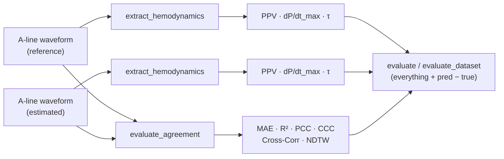

<div align="center">

# hemowave

**Hemodynamic indices and waveform agreement metrics<br>for arterial line (A-line) blood pressure waveforms**

[](https://github.com/shk36/hemowave/actions/workflows/tests.yml)
[](#-installation)
[](LICENSE)

[Installation](#-installation) ·
[Quick start](#-quick-start) ·
[Metrics](#-metrics) ·
[Evaluating a test set](#-evaluating-a-test-set) ·
[Inputs & outputs](#-inputs--outputs) ·
[Reproducibility](#-reproducibility)

</div>

---

`hemowave` takes **invasive arterial blood pressure waveforms in mmHg** and answers two questions:

<table>
<tr>
<th width="50%">🫀 What does this waveform say?</th>
<th width="50%">📈 How close is the estimate to the truth?</th>
</tr>
<tr>
<td>

**Input:** one A-line waveform

| Index | Unit |
|:--|:--|
| PPV | % |
| dP/dt<sub>max</sub> | mmHg/s |
| τ | s |

```python
hw.extract_hemodynamics(aline, fs=100)
```

</td>
<td>

**Input:** a reference and an estimated A-line

| Metric | Best |
|:--|:--|
| MAE · NDTW | 0 |
| R² · PCC · CCC · Cross-Corr | 1 |

```python
hw.evaluate_agreement(ref, est)
```

</td>
</tr>
</table>

These are the implementations used in our study of ABP waveforms reconstructed from PPG, packaged as a library.
A regression test checks that they reproduce the original analysis scripts ([Reproducibility](#-reproducibility)).



## 📦 Installation

```bash
pip install git+https://github.com/shk36/hemowave.git
```

Dependencies: `numpy`, `scipy`, `pandas`, `scikit-learn`, `fastdtw`.
The beat detector of [pyvital](https://github.com/vitaldb/pyvital) 0.4.0 is bundled (MIT), so no deep-learning framework or pyvital version pin is needed.

## 🚀 Quick start

```python
import hemowave as hw

aline = hw.synthetic_abp(seed=0)            # demo A-line: 10.24 s @ 100 Hz, mmHg

hw.extract_hemodynamics(aline, fs=100)
# {'PPV': 11.6, 'dPdt_max': 562.3, 'tau': 0.28,
#  'n_beats': 11, 'n_ppv': 11, 'n_dpdt': 11, 'n_tau': 11}
```

```python
ref, est = hw.synthetic_abp(seed=0), hw.synthetic_abp(seed=1)

hw.evaluate_agreement(ref, est)
# {'MAE': 2.64, 'R2': 0.89, 'PCC': 0.947, 'CCC': 0.947, 'Cross_Corr': 0.955, 'NDTW': 0.0093}

hw.evaluate(ref, est, fs=100)               # all of the above, for both waveforms, plus pred − true
```

Each metric is also available on its own: `hw.ppv`, `hw.dpdt_max`, `hw.tau`, `hw.mae`, `hw.r2`, `hw.pcc`, `hw.ccc`, `hw.cross_corr`, `hw.ndtw`.

---

## 📐 Metrics

Notation: $`P(t)`$ is arterial pressure (mmHg); $`y_n`$ and $`\hat{y}_n`$ ($`n = 1,\dots,N`$) are the reference and estimated waveforms of one segment; $`\bar{y}`$ is a mean.

### Beat segmentation

All three hemodynamic indices share the same beats.

1. **Detect** systolic peaks and diastolic feet with pyvital's `detect_peaks` (Aboy et al.). Band-pass filtering is used only to *locate* beats; every index is computed on the raw mmHg signal.
2. **Pair** each peak with its preceding and following foot → (foot, peak, next foot). Edge peaks without both feet are dropped.
3. **Quality-check** each beat: duration 0.3–3.0 s (20–200 bpm) and pulse pressure 20–100 mmHg.

### 1 · Pulse pressure variation (PPV)

For each beat $`i`$, the pulse pressure is $`PP_i = P(t_{\mathrm{peak},i}) - P(t_{\mathrm{foot},i})`$. Over the beats of a window:

```math
\mathrm{PPV} = \frac{PP_{\max} - PP_{\min}}{\left(PP_{\max} + PP_{\min}\right)/2} \times 100\ \%
```

The whole 10.24 s window is treated as one analysis period (Michard et al.). It is reported as NaN when any of the following holds:

- fewer than $`\lceil 40\ \text{bpm} \times \text{window} / 60\ \text{s} \rceil - 2`$ clean beats (5 for 10.24 s)
- an irregular rhythm: the coefficient of variation of beat duration is above 0.2
- after dropping beats whose shape correlates below 0.9 with the mean beat, too few beats remain
- the result falls outside 0 < PPV < 50 %

### 2 · Maximum systolic upstroke slope (dP/dt<sub>max</sub>)

The first derivative comes from a 5-point, second-order Savitzky–Golay filter, which at interior samples is

```math
\dot{P}_{\mathrm{SG}}(t_n) = \frac{-2P_{n-2} - P_{n-1} + P_{n+1} + 2P_{n+2}}{10\,\Delta t}
```

Each beat $`i`$ takes its maximum over the systolic upstroke (pulse foot → systolic peak):

```math
D_i = \max_{t_{\mathrm{foot},i} \,\le\, t \,\le\, t_{\mathrm{peak},i}} \dot{P}_{\mathrm{SG}}(t)
```

Beat values outside 30–5,000 mmHg/s are excluded, and the window value is the median of the rest:

```math
\left(\frac{dP}{dt}\right)_{\max} = \mathrm{median}\,\big\{\, D_i \;:\; 30 \le D_i \le 5000\ \mathrm{mmHg/s} \,\big\}
```

### 3 · Diastolic decay time constant (τ)

For each beat $`i`$ of duration $`T_i`$ (pulse foot to next foot), fix the asymptotic pressure 5 mmHg below the beat's minimum:

```math
P_{\infty,i} = \min_{t \,\in\, \text{beat } i} P(t) - 5\ \mathrm{mmHg}
```

and fit a log-linear regression over 55–92 % of the beat:

```math
\ln\big(P(t) - P_{\infty,i}\big) = a_i + b_i\,t,
\qquad
t_{\mathrm{foot},i} + 0.55\,T_i \;\le\; t \;\le\; t_{\mathrm{foot},i} + 0.92\,T_i
```

The beat time constant is $`\tau_i = -1/b_i`$. Beat values outside 0.12–1.50 s are excluded, and the window value is the median of the rest:

```math
\tau = \mathrm{median}\,\big\{\, \tau_i \;:\; 0.12 \le \tau_i \le 1.50\ \mathrm{s} \,\big\}
```

A beat is also skipped when the fit has fewer than 3 samples, any $`P(t) - P_{\infty,i} \le 0`$, or $`b_i \ge 0`$.

> [!NOTE]
> dP/dt<sub>max</sub> and τ follow Ensarioğlu & Yıldırım (2026), **adapted** to 100 Hz, 10.24 s windows. The SG kernel is 5 points instead of 21 points at 500 Hz: both span 40 ms, but the kernels differ. Aggregation is over one window instead of one minute, and the beat detector is different. The τ range is applied per beat as an artifact filter rather than as a case-level flag. The docstrings in [`hemodynamics.py`](src/hemowave/hemodynamics.py) state every rule the reference leaves open.

### 4 · Waveform agreement

Each metric compares a reference segment $`y`$ with an estimated segment $`\hat{y}`$ of the same length $`N`$.

**MAE** — mean absolute error, in mmHg (best: 0)

```math
\mathrm{MAE} = \frac{1}{N} \sum_{n=1}^{N} \big|\, y_n - \hat{y}_n \,\big|
```

**R²** — coefficient of determination (best: 1, unbounded below)

```math
R^2 = 1 - \frac{\sum_{n} (y_n - \hat{y}_n)^2}{\sum_{n} (y_n - \bar{y})^2}
```

**PCC** — Pearson correlation; waveform shape only (−1 … 1, best: 1)

```math
\mathrm{PCC} = \frac{\sum_{n} (y_n - \bar{y})(\hat{y}_n - \bar{\hat{y}})}{\sqrt{\sum_{n} (y_n - \bar{y})^2}\;\sqrt{\sum_{n} (\hat{y}_n - \bar{\hat{y}})^2}}
```

**CCC** — Lin's concordance correlation; shape *and* level, so offset and scale errors are penalised (−1 … 1, best: 1)

```math
\mathrm{CCC} = \frac{2\, s_{y\hat{y}}}{s_y^2 + s_{\hat{y}}^2 + (\bar{y} - \bar{\hat{y}})^2},
\qquad
s_{y\hat{y}} = \frac{1}{N} \sum_{n} (y_n - \bar{y})(\hat{y}_n - \bar{\hat{y}})
```

with population variances $`s_y^2`$ and $`s_{\hat{y}}^2`$.

**Cross-Corr** — maximum normalized cross-correlation across all lags $`k`$ (−1 … 1, best: 1)

```math
\text{Cross-Corr} = \max_{k} \frac{\sum_{n} \tilde{y}_n \, \tilde{\hat{y}}_{n+k}}{\lVert \tilde{y} \rVert \, \lVert \tilde{\hat{y}} \rVert},
\qquad
\tilde{y} = y - \bar{y}, \quad \tilde{\hat{y}} = \hat{y} - \bar{\hat{y}}
```

At $`k = 0`$ this equals PCC, so Cross-Corr − PCC shows how much a pure time shift would gain.

**NDTW** — dynamic time warping distance, normalized by segment length and the reference amplitude range (best: 0)

```math
\mathrm{NDTW} = \frac{\mathrm{DTW}(y, \hat{y})}{N \cdot \big( \max_n y_n - \min_n y_n \big)},
\qquad
\mathrm{DTW}(y, \hat{y}) = \min_{\text{warping path } \pi} \sum_{(i,j) \in \pi} \big|\, y_i - \hat{y}_j \,\big|
```

DTW is computed with the FastDTW approximation (Salvador & Chan).

---

## 🗂 Evaluating a test set

```python
# Y, Y_hat: (N, L) or (N, L, 1) arrays — reference and estimated segments, paired by row
df = hw.evaluate_dataset(Y, Y_hat, fs=100, n_jobs=8)                       # → DataFrame, one row per segment
hw.evaluate_dataset(Y, Y_hat, fs=100, n_jobs=8, out_csv="metrics.csv")    # stream to disk, resumable
```

To report results the way the paper does, **pool R² over every sample** and **average the other waveform metrics over segments**:

```python
r = hw.cluster_bootstrap_r2(Y, Y_hat, groups=patient_id)    # global R² + patient-cluster 95 % CI
print(r)                                                    # e.g. R² = 0.957 [0.956, 0.957] (50 segments, 10 patients)

df[["MAE", "PCC", "CCC", "Cross_Corr", "NDTW"]].mean()       # segment-averaged metrics
```

```math
R^2_{\text{global}} = 1 - \frac{\sum_{s}\sum_{n} \big(y_{s,n} - \hat{y}_{s,n}\big)^2}{\sum_{s}\sum_{n} \big(y_{s,n} - \bar{y}\big)^2}
\qquad \text{(all segments } s \text{ and samples } n \text{ flattened)}
```

> [!IMPORTANT]
> The per-segment `R2` column is unbounded below on nearly flat segments, so averaging it does not give the global R². Use `hw.global_r2` or `hw.cluster_bootstrap_r2` instead. The bootstrap resamples **patients**, not segments, because segments from one patient are correlated.

Agreement of the **derived parameters** (reference-derived vs model-derived PPV, dP/dt<sub>max</sub>, τ), using windows where both values are valid:

```python
for k in ["PPV", "dPdt_max", "tau"]:
    d = df[[f"{k}_true", f"{k}_pred"]].dropna()
    err = d[f"{k}_pred"] - d[f"{k}_true"]
    print(k, "MAE", err.abs().mean(), "ME", err.mean(),
          "CCC", hw.ccc(d[f"{k}_true"].to_numpy(), d[f"{k}_pred"].to_numpy()))
```

```math
\mathrm{MAE} = \frac{1}{W}\sum_{w} \lvert \hat{x}_w - x_w \rvert,
\qquad
\mathrm{ME} = \frac{1}{W}\sum_{w} (\hat{x}_w - x_w)
\qquad (\mathrm{ME} > 0 \Rightarrow \text{overestimation})
```

> [!TIP]
> NDTW dominates run time. Pass `agreement=False` if you only need PPV, dP/dt<sub>max</sub> and τ. With `n_jobs > 1`, scripts on macOS and Windows must call it under `if __name__ == "__main__":`.

---

## 🔌 Inputs & outputs

**Input requirements**

- **Signal:** invasive arterial pressure in **mmHg**. A [0, 1]-scaled waveform can be restored with `mmhg_min=` and `mmhg_max=`.
- **Shape:** one segment as `(L,)`, `(L, 1)` or a list. A test set as `(N, L)`, `(N, L, 1)` or a list of segments.
- **Sampling rate:** any `fs` in Hz (beat detection runs internally at 100 Hz). The defaults were tuned on 10.24 s windows at 100 Hz.
- **Pairs:** for agreement, `y_true` and `y_pred` must be time-aligned and of equal length.

> [!WARNING]
> Thresholds are in mmHg: pulse pressure 20–100 mmHg, dP/dt<sub>max</sub> 30–5,000 mmHg/s, and $`P_\infty = \min - 5`$ mmHg. A non-mmHg signal (e.g. raw PPG) still gets beats detected, but every beat fails QC and all three indices are NaN.

<details>
<summary><b>Output of <code>extract_hemodynamics</code></b></summary>

| Key | Meaning |
|:--|:--|
| `PPV` | % |
| `dPdt_max` | mmHg/s, median over valid beats |
| `tau` | s, median over valid beats |
| `n_beats` | beats detected and paired |
| `n_ppv` · `n_dpdt` · `n_tau` | beats that contributed to each index |

An index that cannot be computed is `NaN` and its count is `0`. This happens with too few clean beats, an irregular rhythm, or a flat or non-finite segment.

</details>

<details>
<summary><b>Output of <code>evaluate_agreement</code></b></summary>

`{'MAE', 'R2', 'PCC', 'CCC', 'Cross_Corr', 'NDTW'}`. Raises `ValueError` on non-finite samples or a length mismatch.

</details>

<details>
<summary><b>Columns of <code>evaluate</code> / <code>evaluate_dataset</code></b></summary>

| Columns | Meaning |
|:--|:--|
| `idx` | segment index (`evaluate_dataset` only) |
| `MAE` `R2` `PCC` `CCC` `Cross_Corr` `NDTW` | agreement; NaN if the pair is invalid |
| `PPV_true` `PPV_pred` `PPV_diff` | each waveform's PPV and `pred − true` |
| `dPdt_max_*` · `tau_*` | same for dP/dt<sub>max</sub> and τ |
| `n_beats_*` `n_ppv_*` `n_dpdt_*` `n_tau_*` | beat counts, `_true` / `_pred` |

</details>

<details>
<summary><b>Configuration — every threshold in one place</b></summary>

```python
cfg = hw.HemodynamicConfig(beat_aggregator="mean", tau_max_s=2.0)
hw.extract_hemodynamics(aline, fs=100, config=cfg)
```

| Parameter | Default |
|:--|:--|
| `beat_aggregator` | `"median"` |
| `beat_len_min_s` / `beat_len_max_s` | 0.3 / 3.0 s |
| `pp_min_mmhg` / `pp_max_mmhg` | 20 / 100 mmHg |
| `ppv_min_hr_bpm` | 40 bpm |
| `ppv_rhythm_cv_max` | 0.2 |
| `ppv_shape_corr_min` | 0.9 |
| `ppv_valid_max` | 50 % |
| `dpdt_sg_window_points` / `dpdt_sg_polyorder` | 5 / 2 |
| `dpdt_min_mmhg_s` / `dpdt_max_mmhg_s` | 30 / 5,000 mmHg/s |
| `tau_fit_start_frac` / `tau_fit_end_frac` | 0.55 / 0.92 |
| `tau_pinf_offset_mmhg` | 5 mmHg |
| `tau_min_s` / `tau_max_s` | 0.12 / 1.50 s |

</details>

<details>
<summary><b>Full API</b></summary>

| Function | Returns |
|:--|:--|
| `extract_hemodynamics(waveform, fs)` | dict of indices and beat counts |
| `ppv` · `dpdt_max` · `tau` | float |
| `evaluate_agreement(y_true, y_pred)` | dict of 6 metrics |
| `mae` · `r2` · `pcc` · `ccc` · `cross_corr` · `ndtw` | float |
| `evaluate(y_true, y_pred, fs)` | flat dict, one pair |
| `evaluate_dataset(Y, Y_hat, fs)` | `DataFrame` (or `None` when streaming) |
| `global_r2(Y, Y_hat)` | float |
| `cluster_bootstrap_r2(Y, Y_hat, groups)` | `R2Result(r2, ci_low, ci_high, n_segments, n_patients)` |
| `segment_beats(data, fs)` | `Beats(foots, peaks, next_foots, pulse_pressure, lengths, qc)` |
| `synthetic_abp(...)` | demo waveform |

</details>

<details>
<summary><b>Project layout</b></summary>

```
hemowave/
├── src/hemowave/           # the package (src layout)
│   ├── hemodynamics.py     # PPV, dP/dt_max, τ
│   ├── agreement.py        # MAE, R², PCC, CCC, Cross-Corr, NDTW
│   ├── stats.py            # global R², patient-cluster bootstrap
│   ├── evaluate.py         # evaluate, evaluate_dataset
│   ├── beats.py            # beat detection, pairing, QC
│   ├── config.py           # HemodynamicConfig
│   └── _vendor/            # pyvital 0.4.0 beat detector (MIT)
├── tests/                  # unit tests + equivalence with the original scripts
└── examples/               # quickstart.py, evaluate_model_outputs.py
```

</details>

---

## ✅ Reproducibility

[`tests/test_paper_equivalence.py`](tests/test_paper_equivalence.py) compares `hemowave` against outputs of the original analysis scripts (run with the real pyvital 0.4.0). The test data are 20 **synthetic** segment pairs, some with artifacts; no patient data is included. Beat counts and NaN patterns must match exactly, and all values must agree to a relative 1e-12. On the numpy/scipy versions that produced the reference they are bit-identical. CI runs the suite on Linux, macOS and Windows with Python 3.9, 3.11 and 3.13.

```bash
pip install -e ".[dev]" && pytest
```

The only intentional differences concern input the original code could not handle. Flat or too-short segments made pyvital raise an exception, and `±inf` samples crashed or produced spurious values. `hemowave` returns NaN for both.

## 📚 References

1. Ensarioğlu M, Yıldırım AK. Intraoperative arterial waveform morphology trajectories and prediction of postoperative acute kidney injury: a latent-class analysis of the VitalDB registry. *J Clin Med.* 2026;15(17):6871. [doi:10.3390/jcm15176871](https://doi.org/10.3390/jcm15176871)
2. Michard F, et al. Relation between respiratory changes in arterial pulse pressure and fluid responsiveness in septic patients with acute circulatory failure. *Am J Respir Crit Care Med.* 2000;162(1):134–138.
3. Aboy M, et al. An automatic beat detection algorithm for pressure signals. *IEEE Trans Biomed Eng.* 2005;52(10):1662–1670.
4. Lin LI. A concordance correlation coefficient to evaluate reproducibility. *Biometrics.* 1989;45(1):255–268.
5. Salvador S, Chan P. FastDTW: toward accurate dynamic time warping in linear time and space. *Intell Data Anal.* 2007;11(5):561–580.
6. pyvital — <https://github.com/vitaldb/pyvital> (MIT)

## License

MIT — see [LICENSE](LICENSE). The bundled beat detector is © 2021 VitalDB, MIT.
